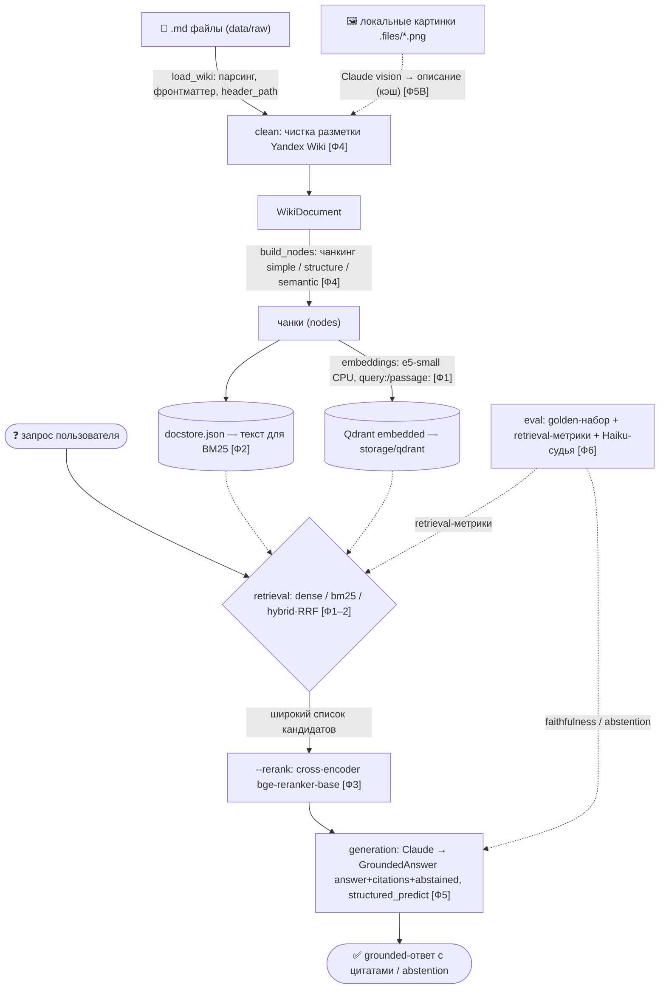

# Как это работает

Короткая карта проекта — чтобы не терять нить между фазами.

## Поток данных

Индексация (offline) слева, ответ на запрос (online) справа; в скобках — фаза.

CLI (всё через `uv run` — подхватывает окружение проекта; про грабли см. README):
- `uv run python -m rag.ingest --path <dir> --show-sections` — посмотреть, как парсятся страницы
- `uv run python -m rag.index build --path <dir>` — собрать/пересобрать индекс (Qdrant + docstore)
- `uv run python -m rag.index build --chunking simple|structure|semantic` — стратегия чанкинга (Фаза 4)
- `uv run python -m rag.index build --captions` — + описать локальные картинки через Claude vision (Фаза 5B, нужен ключ)
- `uv run python -m rag.query "вопрос" --retrieve-only` — только поиск (без API-ключа)
- `uv run python -m rag.query "вопрос" --mode dense|bm25|hybrid` — выбрать режим поиска (по умолч. hybrid)
- `uv run python -m rag.query "вопрос" --rerank` — добавить cross-encoder reranker (Фаза 3)
- `uv run python -m rag.query "вопрос"` — полный grounded-ответ через Claude (нужен ключ в .env)
- `uv run python -m rag.eval --golden deliveryservice.json` — retrieval-ablation по golden-набору (без API, Фаза 6)
- `uv run python -m rag.eval --golden synthetic.json --gate` — CI-гейт: сверка с порогами `eval/baseline.json`, exit 1 при регрессии

> **RRF (Reciprocal Rank Fusion):** у BM25 и косинуса несопоставимые шкалы скоров,
> поэтому складываем не скоры, а РАНГИ: `score(doc) = Σ 1/(k + rank)` (k=60).
> Документ, попавший в топ у обоих ретриверов, поднимается выше одиночных.

## Артефакты на диске (всё в .gitignore)

| Путь | Что это | Можно удалять? |
|------|---------|----------------|
| `storage/qdrant/` | векторный индекс Qdrant (embedded, SQLite + файлы) | да — пересоберётся через `rag.index build` |
| `storage/docstore.json` | сырые ноды для BM25 (лексический поиск) | да — пересоберётся через `rag.index build` |
| `.venv/` | виртуальное окружение uv | да — восстановится через `uv sync` |
| `.env` | секреты (API-ключ) | нет — это твой ключ |
| кэш модели HF | скачанные веса e5 (вне репозитория, в кэше HuggingFace) | да — скачается заново |

> `storage.sqlite` внутри `storage/qdrant/collection/wiki/` — это внутренний файл
> Qdrant, а не твои документы. Там только векторы и метаданные (rel_path, title).

## Тестовые данные vs реальные

- `tests/fixtures/wiki/` — **синтетические примеры** (онбординг, API платежей),
  придуманы для проверки пайплайна и тестов. Это не корпус.
- `data/raw/` — сюда кладётся **реальная вики** (в git не коммитится).

## Зависимости по фазам

| Группа | Пакеты | Когда |
|--------|--------|-------|
| ядро | pydantic, pydantic-settings, python-dotenv, pyyaml, rich | Фаза 0 |
| `phase1` | llama-index-core, -embeddings-huggingface, -vector-stores-qdrant, -llms-anthropic, qdrant-client<1.19, sentence-transformers (+ torch) | Фаза 1 |
| `phase2` | llama-index-retrievers-bm25 (bm25s), **pystemmer** (рус. стеммер, явная зависимость) | Фаза 2 |
| Фаза 3 | reranker переиспользует `sentence-transformers` из phase1; веса `bge-reranker-base` качаются при первом запуске | Фаза 3 |
| Фаза 5 | structured output на `anthropic`/`llama-index-llms-anthropic` из phase1 (новых пакетов нет) | Фаза 5 |
| `eval` | ragas, datasets — опционально, для будущего кросс-чека; текущий eval их НЕ требует | Фаза 6 |
| `dev` | pytest, ruff | всегда |

Установка: `uv sync` (ядро) или `uv sync --group phase1 --group phase2` и т.д.

> **Eval Фазы 6 не тянет внешних зависимостей.** Retrieval-метрики
> (hit@k/MRR/recall@k/precision@k) — чистый Python; generation-метрики
> (faithfulness/answer_relevancy/abstention) — свой лёгкий Haiku-судья
> (`anthropic` из phase1). Запуск:
> `uv run python -m rag.eval --golden deliveryservice.json` (retrieval, без API)
> и `… --generation --limit 16` (generation, мелкие вызовы Haiku).
